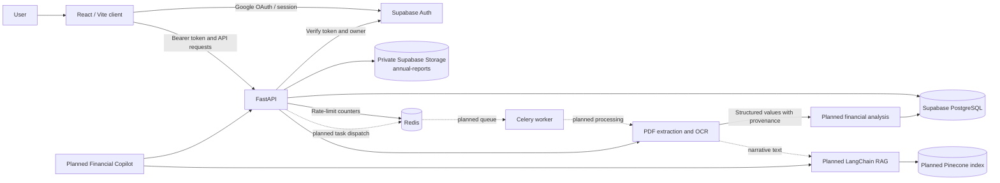

# FinInsight AI

**Intelligent Financial Statement Risk Analyzer**

FinInsight AI is designed to help users understand a company's annual report by extracting financial statements, validating reported values, calculating financial indicators, and presenting potential risks with supporting evidence. A planned report-grounded AI Financial Copilot will help explain report content while keeping financial calculations deterministic and auditable.

## Problem statement

Annual reports are lengthy, inconsistent in layout, and difficult to compare with a company's own historical disclosures. Finding key statement values and interpreting them requires careful manual work. FinInsight AI aims to organize this work into a traceable workflow that preserves the source pages and distinguishes extracted facts from calculated analysis.

## Objectives

- Accept and securely manage a company's annual report PDF.
- Extract income statement, balance sheet, and cash flow information across varied report layouts.
- Use OCR only when a page has insufficient machine-readable text.
- Normalize and validate values while retaining source, period, currency, units, and uncertainty.
- Provide deterministic financial calculations and explainable risk indicators.
- Support report-grounded narrative questions with authorized retrieval and citations.

The product analyzes one company's report at a time. Comparing two companies or their financial performance is out of scope.

## Capabilities

The repository provides a React sign-in client using Supabase Google OAuth, a FastAPI foundation, Supabase JWT verification, report metadata and private PDF storage APIs, SQLAlchemy models and Alembic migrations, Redis-backed API rate limiting, and a standalone PDF extraction pipeline. The PDF pipeline extracts text and tables, detects financial statement pages, selectively invokes Tesseract OCR, and returns normalized values with validation and source references.

Financial ratio analysis, risk scoring, dashboard results, Celery task dispatch for report processing, Pinecone indexing, and AI Copilot conversations are product capabilities planned for later implementation. The core infrastructure for Celery and Redis is configured, but report processing is not currently dispatched to a worker. See [AGENT_CONTEXT.md](AGENT_CONTEXT.md) for the precise implementation, testing, and limitation record.

## Technology stack

| Area | Technology |
|---|---|
| Frontend | React, Vite, Tailwind CSS, Supabase JavaScript client |
| Runtime | Python 3.14 |
| API | FastAPI and Uvicorn |
| Authentication | Supabase Auth with Google OAuth; verified Supabase access tokens |
| Relational data | Supabase PostgreSQL, SQLAlchemy 2.0, Alembic |
| Private file storage | Supabase Storage |
| Background processing foundation | Celery and Redis |
| PDF text and table extraction | PyMuPDF and pdfplumber |
| OCR | Tesseract OCR through pytesseract |
| Data handling | Pandas and NumPy |
| Planned retrieval | LangChain and Pinecone |
| Containers | Docker and Docker Compose |
| Cloud target | Microsoft Azure; specific services are to be selected |

Provider-specific LLM and embedding technologies have not been selected. The project does not install or assume a provider integration until that decision is made.

## Architecture



The PDF extraction pipeline is reusable independently of FastAPI and is designed for later worker invocation. The diagram's dotted connections denote planned processing integration, not active task dispatch. PostgreSQL is the source of truth for user profiles, report metadata, processing records, and future structured analysis. Redis is used for rate-limit state and is configured as the Celery broker; it is not the durable application database.

## System components

- **Frontend:** React application for Supabase-managed Google sign-in and API access.
- **API and security:** FastAPI routes, verified user identity, ownership-scoped report operations, request validation, CORS, rate limiting, centralized errors, and redacted JSON logs.
- **Auth and profiles:** Supabase Auth manages identity; the `profiles` table stores application-specific profile fields keyed by the Supabase user UUID.
- **Reports and storage:** `reports` stores PDF metadata and status. PDF bytes live in the private `annual-reports` Supabase Storage bucket.
- **Database:** `processing_jobs` records processing attempts; Alembic manages application schema changes.
- **PDF processing:** PyMuPDF loads and extracts page text, statement detection selects likely financial pages, pdfplumber extracts tables, Pandas-based normalization structures values, and pytesseract invokes Tesseract for selected scanned pages.
- **Worker infrastructure:** Docker Compose defines the API, Redis, and a Celery worker. Report-processing tasks are not yet dispatched.
- **Financial analysis:** Planned deterministic calculations, ratios, risk rules, and health scoring.
- **Narrative retrieval and Copilot:** Planned report chunking, authorized retrieval with LangChain and Pinecone, and grounded responses from a provider that will be selected later.

## Data flow

1. A user signs in with Google through Supabase Auth. The frontend sends the Supabase access token to FastAPI.
2. FastAPI verifies the token and derives the user UUID from the verified identity.
3. An authenticated user uploads a PDF. The API checks the extension, declared media type, PDF signature, size limit, and parseability before storing it in the private bucket.
4. PostgreSQL stores report metadata and ownership. Report access is scoped to the authenticated user's UUID; storage paths are not accepted as authorization input.
5. The standalone processor reads a controlled PDF input or an authorized stored report. It extracts page text, detects statements, extracts tables, selectively runs OCR, and returns normalized values with page/table provenance and validation warnings.
6. Future worker integration will run long-running processing outside HTTP requests. Future analysis and RAG stages will consume the extracted data through separate structured-finance and narrative-retrieval paths.

## Data and security design

The relational schema contains three application models:

- `profiles`: application profile fields keyed by the Supabase Auth user UUID.
- `reports`: report metadata, owner, storage reference, file details, processing status, and deletion/cleanup state.
- `processing_jobs`: individual processing attempts associated with a report.

Original PDF bytes remain in Supabase Storage. The bucket is private, downloads use short-lived signed URLs after an ownership check, and browser clients do not receive the service-role key. Database operations use SQLAlchemy ORM expressions and Alembic migrations. Application-level ownership checks remain required when backend credentials bypass Supabase RLS.

The extraction pipeline retains unknown or questionable values with warnings instead of silently turning missing values into zero or guessing currency and units. Financial arithmetic is intended to use deterministic Python logic. Future AI retrieval must treat document text as untrusted, enforce authorization on the server, and ground answers in report evidence.

## Local development

### Prerequisites

- Python 3.14
- Node.js and npm
- Docker Desktop with Docker Compose (for Redis and the Linux Celery worker)
- A Supabase project configured for Google OAuth
- Tesseract OCR on the host if running OCR outside Docker

### Backend

In PowerShell:

```powershell
cd backend
py -3.14 -m venv .venv
.\.venv\Scripts\Activate.ps1
python -m pip install --upgrade pip
pip install -r requirements.txt
Copy-Item .env.example .env
```

Set the required values in `backend/.env`, then start Redis and the API:

```powershell
docker compose up redis -d
uvicorn app.main:app --reload
```

The API health endpoint is `http://localhost:8000/api/v1/health`. The local API requires both Redis and a reachable PostgreSQL database at startup: Redis initializes distributed rate limiting, and the startup check verifies the database connection. Set `DATABASE_URL` to a development Supabase PostgreSQL connection string before starting the API. The health endpoint reports process liveness; it is not a separate readiness probe.

### Frontend

In another PowerShell window:

```powershell
cd frontend
npm install
Copy-Item .env.example .env.local
npm run dev
```

Set `VITE_SUPABASE_URL` and `VITE_SUPABASE_PUBLISHABLE_KEY` in `frontend/.env.local`. Configure Google as a Supabase Auth provider and add the local OAuth callback URL, `http://localhost:5173/auth/callback`, to the Supabase redirect allow-list. Do not place the Supabase service-role key or Google client secret in frontend configuration.

### API, worker, and Redis containers

From the repository root, after configuring `backend/.env`:

```powershell
docker compose up --build
```

This runs the FastAPI API, Redis, and one Celery worker in Linux containers. The frontend runs separately with Vite. The worker infrastructure is present; report processing is not currently connected to Celery tasks.

### Run the standalone PDF processor

From `backend/`:

```powershell
python -m app.modules.pdf_processing.cli C:\path\to\annual-report.pdf
```

On Windows, install Tesseract separately, add its executable directory (commonly `C:\Program Files\Tesseract-OCR`) to `PATH`, restart PowerShell, and verify it with `tesseract --version`. Set `TESSERACT_CMD` only if it is not found through `PATH`. The backend Docker image installs the Linux Tesseract executable.

### Database migrations

From `backend/`, configure `DATABASE_URL` to a development database and inspect migrations before applying them:

```powershell
python -m alembic history
python -m alembic revision --autogenerate -m "describe schema change"
python -m alembic upgrade head
```

Review generated migration files before use. Do not point development commands at production without a production migration plan.

## Configuration

Backend placeholders are listed in `backend/.env.example`. Main settings include:

| Variable | Purpose |
|---|---|
| `SUPABASE_URL` | Supabase project URL |
| `SUPABASE_PUBLISHABLE_KEY` | Public key for browser client and legacy token validation |
| `SUPABASE_SERVICE_ROLE_KEY` | Server-only Supabase Storage access; never expose to the client |
| `DATABASE_URL` | PostgreSQL connection string for SQLAlchemy/Alembic |
| `REDIS_URL` | Redis connection for API rate limiting and Celery broker |
| `FRONTEND_ORIGINS` | Comma-separated allowed browser origins |
| `MAX_PDF_SIZE_BYTES` | Upload and processing file-size limit |
| `PDF_PROCESSING_MAX_PAGES` | Maximum pages accepted by the processor |
| `PDF_TEXT_MIN_CHARACTERS` | Threshold for insufficient selectable text |
| `PDF_OCR_DPI`, `PDF_OCR_TIMEOUT_SECONDS` | OCR resource and time limits |
| `REPORT_DOWNLOAD_URL_TTL_SECONDS` | Signed download URL lifetime |
| `TESSERACT_CMD` | Optional executable path when not available through `PATH` |
| `PINECONE_API_KEY`, `PINECONE_INDEX_NAME` | Reserved for future retrieval integration |

The frontend uses only `VITE_SUPABASE_URL` and `VITE_SUPABASE_PUBLISHABLE_KEY`. Google OAuth client credentials are configured in Supabase, not in this application. Keep all secrets in local environment files or a managed secret store; never commit real credentials.

## Scope and design principles

- One company's report is analyzed at a time; two-company comparison is excluded.
- Financial calculations are deterministic and auditable, not generated by an LLM.
- Structured financial extraction and narrative RAG are separate pipelines.
- PostgreSQL is the durable relational source of truth; Redis is infrastructure for rate limiting and task brokering.
- Supabase Auth owns credentials and identity; the application does not implement password authentication.
- AI providers, embedding providers, and specific Azure services remain unselected.

For detailed engineering decisions, module responsibilities, security requirements, implementation records, known limitations, and agent workflow rules, read [AGENT_CONTEXT.md](AGENT_CONTEXT.md) before contributing.
